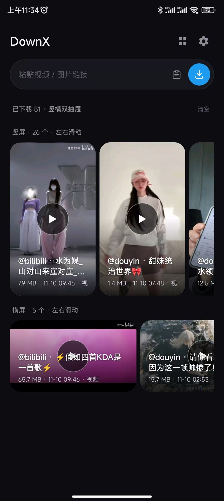
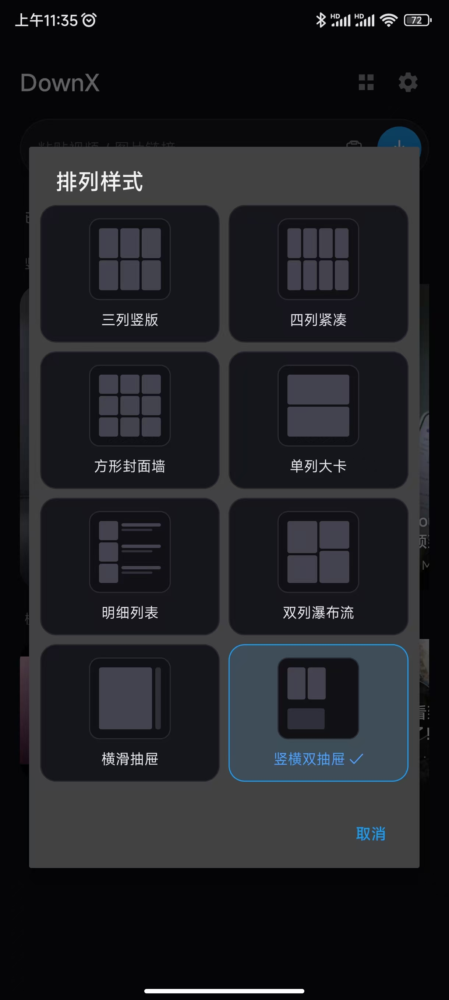
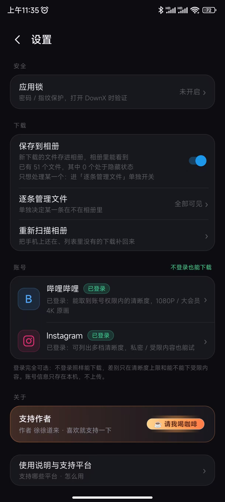
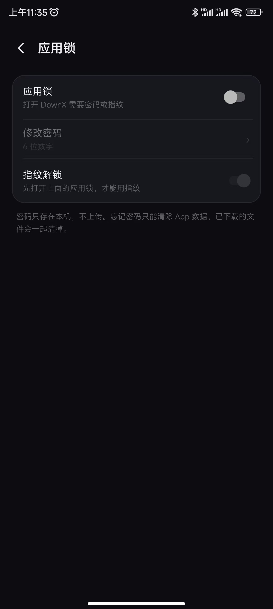
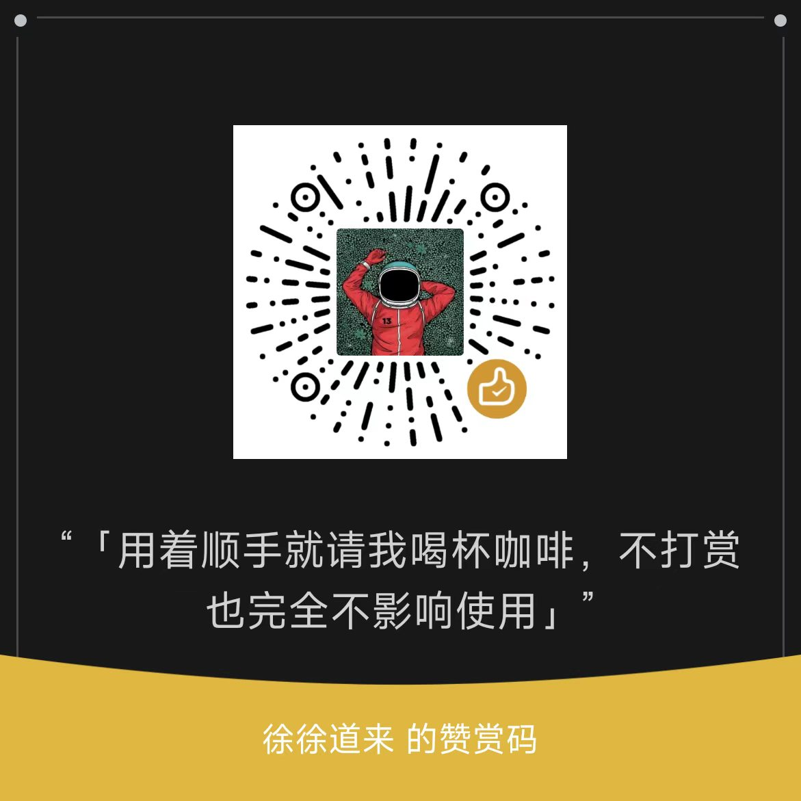

# DownX

一个安卓手机上的视频 / 图片下载工具。**复制链接 → 粘贴 → 下载**，就这么简单。
不登录、不注册、不要会员，装完就能用。

### [⬇ 下载最新版 APK](https://github.com/liaoningxhr/DownX/releases/latest)

> 大小约 560 KB，支持 Android 7.0 及以上。

## 界面预览

| 主页 · 竖横双抽屉 | 排列样式，想怎么摆就怎么摆 |
| :---: | :---: |
|  |  |
| 账号与应用锁 | 应用锁 · 密码 / 指纹 |
|  |  |

---

## 安装

1. 点上面那条下载链接，把 `DownX-v1.0.1.apk` 下到手机
2. 打开它，系统会问「是否允许安装未知来源应用」→ 允许
3. 装好后桌面出现 **DownX** 图标

## 怎么用

1. **复制链接**：在抖音 / 快手/ 小红书/ B 站 / 微博等 App 里点「分享 → 复制链接」
2. **粘贴**：打开 DownX，链接会自动填进输入框（没自动填就手动粘贴）
3. **选清晰度**：能选 1080P 就选 1080P，想省流量选 720P
4. **点下载**：进度条走完，文件就进相册了

下载完成后：

- **看视频**：在 DownX 首页点那个视频 → 播放器打开
  - 左右滑：切上一条 / 下一条
  - 上下滑：左边调亮度、右边调音量
  - **双指捏合**：放大画面，轻点一下还原
- **看图**：点图片 → 双指放大，单指拖动看细节
- **一次下多张图**：首页只显示一张缩略图，右上角有数量角标，点开就是整组

## 支持的平台

| 平台 | 能下什么 |
|---|---|
| 抖音、快手、TikTok | 无水印视频 |
| B 站 | 720P 免登录；App 内登录后 1080P，大会员 4K |
| 小红书 | 小宇宙 | 播客音频原文件 |
| 微博、图虫 | 图片原图、原图组 |
| Instagram | 帖子、Reels（免登录） |
| X（Twitter） | 视频原片 |
| Facebook、Pinterest | 公开的图片 / 视频 |
| YouTube | **暂时用不了**（平台要求登录验证） |

## 常见问题

**下载的文件在哪？**
视频在 `Movies/DownX`，图片在 `Pictures/DownX`，系统相册里也能直接看到。

**提示「签名冲突」装不上？**
手机上装过测试版（不同签名），先卸载旧的再装这个。

**首页记录不见了，但相册里文件还在？**
进「设置 → 重新扫描相册」，会把已经存在的文件重新纳入记录。

**下载到一半取消了，还能接着下吗？**
可以，在下载列表里点继续；如果失败了重新点会从头开始，半成品会自动清掉，不占空间。

**B 站 1080P 提示要登录？**
App 里点「B 站登录」，用手机 B 站扫码即可，登录状态只存在本机。

## 说明

本工具只用于下载**自己发布的内容**或**已获授权的内容**做备份，请勿用于侵犯他人版权。下载内容的版权归原平台与原作者所有，二次传播的后果由使用者自行承担。

界面上的赞赏码是给愿意支持后续开发的，**不给钱也能用全部功能**。

---

开发相关（点开）

纯 Java + 原生 View，零第三方依赖，不用 AndroidX / Compose / Kotlin，APK 约 560 KB。
`minSdk 24` / `targetSdk 34`；构建 `sh scripts/build.sh`，签名 `sh scripts/sign.sh 1.0.1`。

架构与踩坑记录在 [`docs/`](docs/)：`原理与架构.md`、`代码地图.md`、`经验与坑.md`。

---

## 赞赏

如果 DownX 用着顺手，可以扫上面这杯咖啡 ☕

赞赏完全自愿、属于赠与性质，**不打赏也完全不影响任何功能**；单笔支持 1～200 元。
